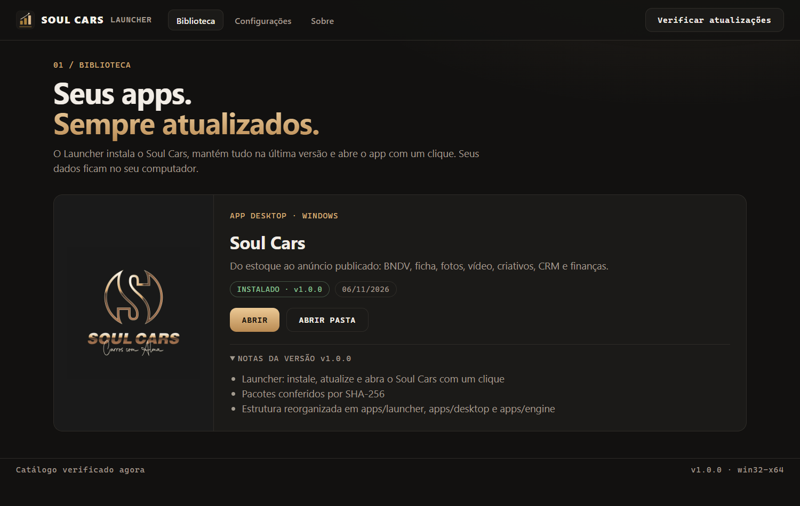
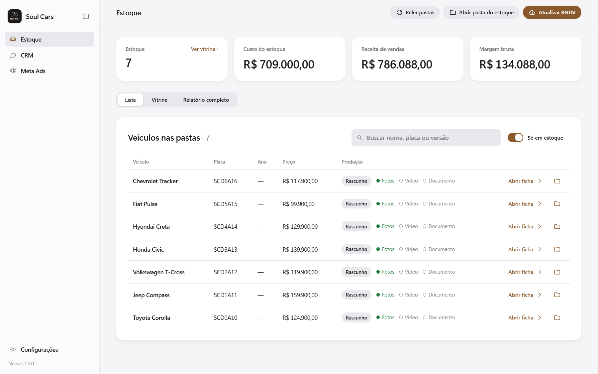
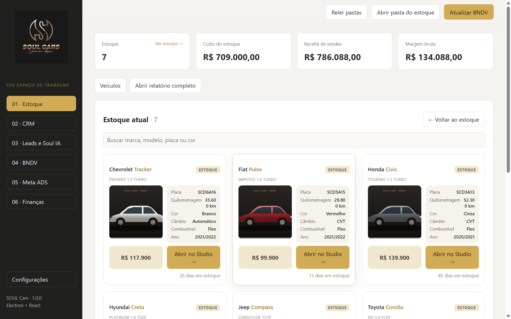
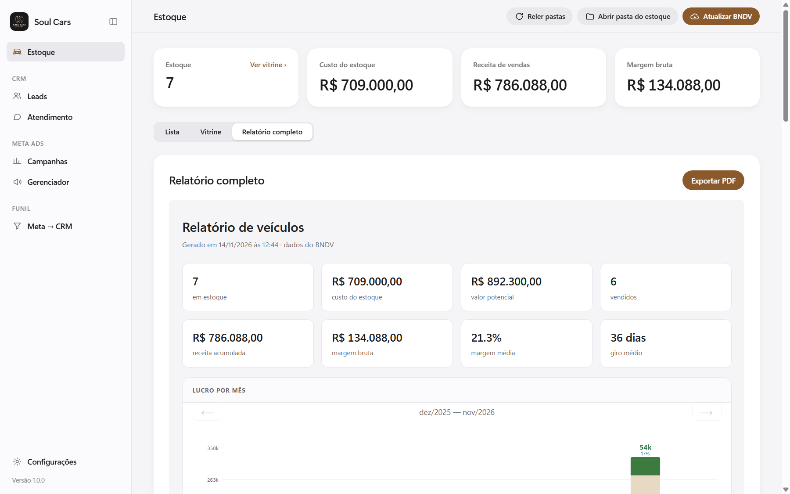
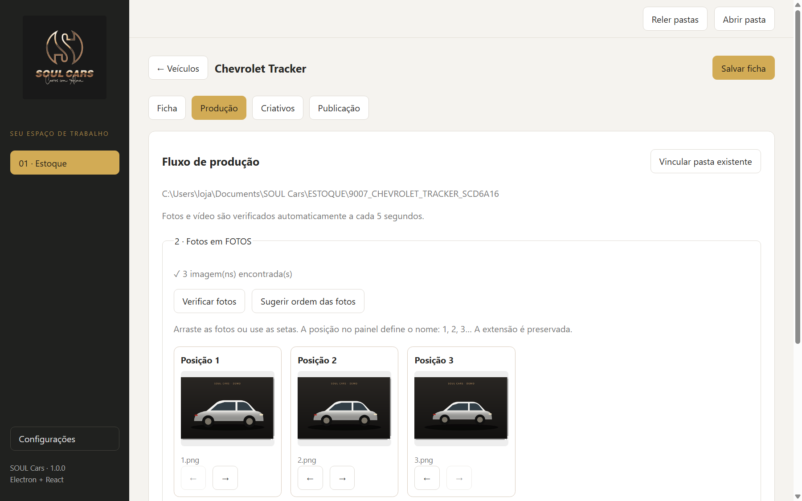

<div align="center">


# Soul Cars

**Do estoque ao anúncio publicado. Num app só, no seu computador.**

Plataforma desktop para revendas de veículos: estoque do BNDV, ficha e documento,
fotos, vídeo, criativos, anúncio, Instagram, CRM, Soul IA e finanças.

[**Baixar o Launcher**](../../releases/latest) · [Apresentação](website/index.html) · [Documentação](docs/README.md) · [Changelog](CHANGELOG.md)

`WINDOWS 10/11 x64` · `LOCAL-FIRST` · `SEM MENSALIDADE DE API` · `ATUALIZAÇÃO AUTOMÁTICA`



</div>

---

## 01 / Por que Soul Cars

Uma revenda passa o dia trocando de ferramenta: o sistema de estoque, o Drive com as fotos,
o editor de vídeo, o Canva, o Gerenciador de Anúncios, o CRM, a planilha do mês. O Soul Cars
junta tudo num fluxo só, **carro por carro**, e deixa cada anúncio pronto para publicar.

| | |
|---|---|
| **Estoque sincronizado** | Lê veículos e vendas do BNDV, cria uma pasta por carro e calcula patrimônio, giro e margem. |
| **Ficha automática** | Lê o CRLV (PDF ou escaneado), busca a ficha técnica na web e gera a descrição do anúncio. |
| **Studio de produção** | Ordena e recorta fotos, monta o vídeo com tarjas e legendas animadas, gera os criativos. |
| **Pronto para anunciar** | Checklist, textos, títulos e arquivos do anúncio com botão de copiar; lembrete de pausa ao vender. |
| **Instagram** | Carrossel e Reels publicados pelo navegador integrado, com retomada e sem duplicatas. |
| **CRM e Soul IA** | Leads por etiqueta, demanda por modelo, desempenho do atendimento e memória das conversas. |
| **Finanças** | Contas do mês direto da planilha da loja, com backup a cada edição. |

## 02 / Telas

<table>
<tr>
<td width="50%"><br /><sub><b>Estoque</b> — métricas do balanço e situação de produção de cada carro.</sub></td>
<td width="50%"><br /><sub><b>Vitrine</b> — o estoque atual em cartões, com foto, preço e dias em estoque.</sub></td>
</tr>
<tr>
<td><br /><sub><b>Relatório completo</b> — patrimônio, margem média, giro e lucro por mês, com PDF A4.</sub></td>
<td><br /><sub><b>Produção</b> — fotos ordenadas, recorte de fundo e Editor Mágico de vídeo.</sub></td>
</tr>
</table>

> Prints gerados com dados e ilustrações **fictícios** (`npm run screenshots`). Nenhum dado
> real de veículo, cliente ou loja é versionado neste repositório.

## 03 / Instalar

> **Windows 11 com Smart App Control ligado:** o pacote do GitHub ainda não tem assinatura
> digital e pode ser bloqueado. A versão da **Microsoft Store** é assinada pela Microsoft e
> abre normalmente (em preparação: veja [docs/guides/microsoft-store.md](docs/guides/microsoft-store.md)
> e [docs/guides/smart-app-control.md](docs/guides/smart-app-control.md)).

1. Baixe **`soul-cars-launcher-setup-<versão>.exe`** na [última release](../../releases/latest).
2. Execute. Na primeira vez o Windows pode mostrar *"O Windows protegeu o seu PC"* (o instalador
   ainda não tem assinatura digital paga): clique em **Mais informações › Executar assim mesmo**.
3. No Launcher, clique em **Instalar** no cartão do Soul Cars e depois em **Abrir**.

Pronto. Quando sair uma versão nova, o cartão mostra **Atualizar para vX.Y.Z**; o Launcher baixa,
confere a assinatura SHA-256 e instala ao lado da versão atual, sem tocar nos seus dados.

<details>
<summary><b>Como as atualizações funcionam</b></summary>

```text
tag v1.1.0 ──► GitHub Actions ──► Release: app .zip + Launcher .exe + manifest.json
                                             │
Launcher ◄── releases/latest/download/manifest.json (versão, notas, SHA-256)
   │
   ├─ baixa o .zip (.part) → confere tamanho e SHA-256 → extrai em apps\soul-cars\<versão>
   ├─ ativa a nova versão e guarda a anterior (volta atrás se precisar)
   └─ se houver Launcher novo: baixa, confere e se reinstala em silêncio
```

Detalhes em [docs/architecture/launcher-and-updates.md](docs/architecture/launcher-and-updates.md).
</details>

## 04 / Princípios

- **Local-first.** Banco, fotos, vídeos e documentos ficam na máquina da loja.
- **Custo zero por uso.** Nenhuma API paga, nenhuma chave. Textos de IA saem por um *prompt pronto*
  colado no chat que a equipe já usa.
- **Nada é publicado sozinho.** O app deixa tudo pronto; uma pessoa revisa e publica.
- **Seguro por padrão.** Interface sem acesso a Node, comandos IPC com esquema, sites externos sem
  ponte, token do CRM cifrado, pacotes conferidos por SHA-256.

## 05 / Arquitetura

```text
soul-cars/
├── apps/
│   ├── launcher/        Soul Cars Launcher — Electron + TypeScript puro
│   │   └── src/{main,preload,shared,renderer}
│   ├── desktop/         Soul Cars — Electron + React 19 + TypeScript
│   │   ├── src/main/        core · ipc · window · inventory · studio · crm · soul-ai · finance
│   │   ├── src/preload/     ponte segura window.soul
│   │   ├── src/shared/      regras puras (anúncio, entrada, Instagram, vitrine…)
│   │   ├── src/renderer/    app/ (shell) · pages/<área>/ · lib/ · public/creative-editor
│   │   ├── tests/           Vitest + fixtures
│   │   └── scripts/         smoke em Electron real e prints do README
│   └── engine/          motor Python 3.12 (uv): documents · specs · media · spreadsheets · video
├── scripts/release/     gera o manifest.json da release
├── website/             página de apresentação (GitHub Pages)
├── docs/                guias, arquitetura, desenvolvimento, CRM, vídeo, planejamento
└── .github/workflows/   CI (lint, tipos, testes, motor, smoke) e Release por tag
```

| Camada | Tecnologia |
|---|---|
| Desktop | Electron 44 · electron-vite · Vite 7 · React 19 · TypeScript 5 (strict) |
| Dados | SQLite embutido (`node:sqlite`), migrações versionadas |
| Motor | Python 3.12 + uv · pdfplumber · Tesseract · rembg/ONNX · CLIP · faster-whisper · FFmpeg · openpyxl |
| Qualidade | ESLint · Prettier · Vitest · unittest · smoke e E2E em Electron real · GitHub Actions |
| Entrega | electron-builder (zip + NSIS) · GitHub Releases · manifesto com SHA-256 |

Inventário completo em [technology-stack.md](docs/architecture/technology-stack.md) e a crítica
técnica com o roadmap em [technical-review.md](docs/architecture/technical-review.md).

## 06 / Desenvolvimento

Requisitos: Windows 10/11 x64, Node.js 22.16+, Git. Para o motor: [uv](https://docs.astral.sh/uv/),
Tesseract (português) e FFmpeg.

```bash
npm install
npm run dev               # app desktop com recarga automática
npm run dev:launcher      # Launcher
```

| Comando | Para quê |
|---|---|
| `npm run lint` / `npm run typecheck` / `npm run format:check` | Qualidade (zero avisos) |
| `npm test` | Vitest do app e do Launcher |
| `npm run test:engine` | Testes do motor Python |
| `npm run smoke` · `npm run smoke:instagram` | Electron real com dados temporários |
| `npm run e2e:launcher` | Launcher instala o app de um feed local (exige `package:desktop`) |
| `npm run screenshots` | Regera os prints do README com dados fictícios |
| `npm run package:desktop` · `npm run package:launcher` | Pacotes em `apps/*/dist` |

**Publicar uma versão:** adicione a seção em `CHANGELOG.md`, depois

```bash
git tag v1.1.0
git push origin v1.1.0
```

O workflow `release.yml` testa, empacota, gera o `manifest.json` e publica a release; os
Launchers instalados avisam a equipe na próxima abertura.

## 07 / Licença

© 2026 **Atto Comunicação**. Todos os direitos reservados — veja [LICENSE](LICENSE). Bibliotecas,
fontes e modelos de terceiros seguem as próprias licenças ([THIRD_PARTY_NOTICES.md](THIRD_PARTY_NOTICES.md)).
Marca e logo Soul Cars pertencem aos seus titulares.
