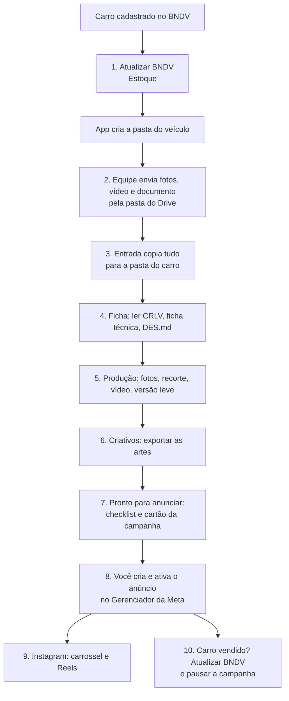

# Manual do Usuário: do carro no estoque ao anúncio no ar

Para quem usa o app no dia a dia da SOUL Cars. Não é preciso saber programar. Se algo não funcionar, vá direto à seção [Problemas comuns](#problemas-comuns).

## O caminho completo (visão de roadmap)

| Etapa | Onde no app | Tempo típico | Você precisa fazer |
|---|---|---|---|
| 1. Atualizar estoque | Estoque › **Atualizar BNDV** | ~1 min | Fazer login no BNDV na primeira vez |
| 2. Receber arquivos | Estoque › **Entrada** | automático (a cada 30 s) | Escolher a pasta sincronizada uma única vez |
| 3. Ficha do carro | Studio › veículo › ficha | alguns min | Conferir os dados lidos |
| 4. Produção | veículo › **Produção** | depende do vídeo | Conferir fotos e vídeo |
| 5. Criativos | veículo › **Criativos** | alguns min | Ajustar as artes e exportar |
| 6. Pronto para anunciar | veículo › **Pronto para anunciar** | poucos min | Copiar textos e criar o anúncio na Meta |
| 7. Instagram | veículo › **Instagram** | alguns min | Fazer login e aprovar a publicação |
| 8. Pausa | Aviso automático | — | Pausar a campanha quando o carro sair |

> **Regra de ouro:** o app **nunca** publica nem ativa um anúncio sozinho. Você sempre aprova.

---

## Antes de começar (primeira vez)

1. Abra o app **SOUL Cars**. Ele abre em **01 · Estoque**.
2. Vá em **Studio › Configurações** e confira:
   - **Raiz de dados**: a pasta que contém `ESTOQUE` e `dados` (não é a própria `ESTOQUE`).
   - Dados da loja (nome, telefone, etc.).
   - **Campanha modelo**: o nome da campanha que você duplica no Gerenciador de Anúncios.
3. Para as automações (ler documento, recortar fundo, editar vídeo), clique em **Instalar / reparar motor Python**. Peça ajuda ao responsável técnico se faltar algum programa (uv, Tesseract ou FFmpeg).

## Etapa 1: Atualizar o estoque

1. Em **Estoque**, clique em **Atualizar BNDV**.
2. Uma janela do BNDV abre. Na primeira vez, faça login; nas próximas, o app entra sozinho.
3. Aguarde cerca de 1 minuto. O app baixa veículos e vendas e cria uma pasta para cada carro novo:
   `ESTOQUE/<ID>_<MARCA>_<MODELO>_<PLACA>/` com `INFO.md`, `CRIATIVO`, `FOTOS` e `VIDEO`.
4. Confira a lista de veículos e o **Balanço** (patrimônio, lucro, giro e margem). **Abrir relatório completo** mostra os gráficos dentro do app.

Boas práticas:
- **Reler pastas** só lê o computador; **Atualizar BNDV** usa a internet. A lista se relê sozinha a cada minuto quando nada está aberto.
- Nenhuma pasta é apagada, mesmo que o carro saia do estoque.
- Carros **consignados** não entram no custo do patrimônio; a margem mostrada é bruta.

## Etapa 2: Receber os arquivos da equipe (Entrada)

A equipe sobe fotos, vídeo e documento numa subpasta do Google Drive (ou OneDrive) com a **placa no nome**, por exemplo `TORO - ABC1D23`.

1. Em **Estoque › Entrada**, escolha a pasta sincronizada (só uma vez).
2. O app confere a cada 30 segundos. Use **Verificar agora** para forçar.
3. Os arquivos são **copiados** (nunca movidos nem apagados da origem):
   - fotos (jpg, jpeg, png, webp) → `FOTOS`. HEIC é copiado com aviso, porque o app não o exibe;
   - vídeo (mp4, mov, mkv, avi) → `VIDEO`;
   - PDF → `DOC.pdf`.
4. O que não puder ser copiado vira **pendência**: placa sem carro ou com mais de um carro, tipo desconhecido, vídeo bruto que já existe, PDF que já existe ou mais de um PDF. Resolva a pendência e verifique de novo.
5. Quando o carro estiver fechado e tudo conferido, use **Liberar espaço**: só os arquivos marcados e confirmados por tamanho e hash vão para a **Lixeira** do Windows.

## Etapa 3: Ficha do veículo

Em **Studio**, abra o veículo.

1. Revise os dados da ficha.
2. **Documento:** o app detecta o PDF na pasta (DOC.pdf tem prioridade). Clique em **Ler documento e preencher ficha**; se o PDF tiver senha, informe-a. Isso gera `DOC.md`.
3. **Ficha técnica:** busque pelo Carros na Web (escolhendo a versão, com equipamentos de série) ou cole a ficha / transcreva de um print.
4. **Descrição:** gere o `DES.md` (padrão) ou use **Textos pelo chat (prompt pronto)**: o app monta o prompt, você cola no chat que já usa (Claude, ChatGPT…), cola a resposta de volta e o app valida. Sem chave e sem custo. O app mantém preço, km e ano da ficha.
5. Salve.

## Etapa 4: Produção

Aba **Produção** (a primeira ao abrir o carro). A tela atualiza a cada 5 segundos; use **Verificar documento / fotos / vídeo** para forçar.

- **Fotos:** arraste para mudar a posição ou use as setas. **Sugerir ordem das fotos** (opcional, usa o motor). **Renomear pela ordem do painel** aplica 1, 2, 3… sem sobrescrever originais.
- **Vídeo:** deixe **um único** vídeo bruto em `PROJETO`, `VIDEO` ou na raiz da pasta. Clique em **Editor Mágico** para gerar `VIDEO_<MARCA>.mp4` com tarjas, legendas e trilha.
- **Versão leve para anúncio:** **Gerar versão leve para anúncio** cria `ANUNCIO/ANUNCIO_<MARCA>.mp4` (cerca de 10 Mbps; meta: abaixo de 100 MB). O vídeo original não muda. Só um vídeo é gerado por vez.

## Etapa 5: Criativos

Aba **Criativos**: ajuste os layouts (4 e 6), sombra e piso, e **exporte** os PNGs para `CRIATIVO`. O arquivo principal do anúncio de foto é `<nome>-<ano>-trafego-pago.png`. Para o Instagram, o app também usa o carrossel (1, 2 e 3) e a capa.

## Etapa 6: Pronto para anunciar

Aba **Pronto para anunciar**.

1. **Checklist:** documento lido, fotos numeradas sem buracos, vídeo gerado, versão leve, `DES.md` e criativo de foto. Cada pendência tem um botão **Resolver** que leva à aba certa.
2. **Cartão da campanha:** nome (com prefixo `[VENDA]`), os 5 textos principais, 5 títulos, 5 descrições, mensagens do WhatsApp e os arquivos exatos, com **Copiar** e **Abrir pasta**.
3. No **Gerenciador de Anúncios da Meta**, duplique a campanha modelo (vendas, WhatsApp, 28 a 60 anos, raio de 15 km, SP, R$ 15 por dia), cole os textos e troque os arquivos. **Você ativa.**
4. Volte ao app e clique em **Registrar anúncio criado** (guarda data e nome da campanha).

## Etapa 7: Publicação e Instagram

- **Publicação:** blocos de texto prontos para copiar. O botão mostra **✓ Copiado**.
- **Instagram:**
  1. Informe o usuário da loja, sem `@`, e **Salvar conta**.
  2. Se faltarem criativos, **Baixar carrossel e capa**.
  3. **Abrir Instagram no app**, faça login e resolva as verificações.
  4. Revise imagens e legendas e clique em **Publicar carrossel e depois Reels**. O app confere se a conta conectada é a salva.
- Se algo falhar: **Retomar publicação do Reels** continua sem repetir o carrossel. Se o app fechar após clicar em Compartilhar, abra o perfil e marque **Já foi publicado** ou **Não foi publicado**. Isso evita postar duas vezes.
- **Interromper automação** para os próximos passos; confira o perfil se o envio já começou.

## Etapa 8: Quando o carro for vendido

1. Clique em **Atualizar BNDV** (o lembrete depende de `bndv_vendas.csv`).
2. Se um anúncio registrado e ainda não pausado for de um carro vendido, aparece **"Pause a campanha de <modelo>"** nas duas interfaces.
3. Pause a campanha no Gerenciador e clique em **Marcar como pausada**.
4. Se os dados do BNDV tiverem mais de 24 horas e houver anúncio no ar, o app avisa que estão velhos.

## Relatórios

**Studio › Relatórios** reúne os relatórios Meta Ads e a exportação em planilha (XLSX). O gráfico de **lucro por mês** mostra os últimos 12 meses e tem setas para navegar.

## Problemas comuns

| Sintoma | O que fazer |
|---|---|
| "Uma atualização já está em andamento" | Aguarde terminar. Se travou, feche e reabra o app |
| Lista de carros vazia | Confira a **Raiz de dados** em Configurações e clique em **Atualizar BNDV** |
| BNDV pede login de novo | Faça login na janela que abrir; a sessão fica salva |
| Botões de documento, recorte ou vídeo falham | Em Configurações, **Instalar / reparar motor Python**; confirme uv, Tesseract e FFmpeg |
| Arquivo da Entrada ficou como pendência | Confira a placa no nome da pasta e se existe um único veículo com essa placa |
| "A entrada está copiando arquivos" | O vídeo e a cópia não rodam juntos; aguarde terminar |
| Instagram parou no meio | Veja **Retomada** acima; nunca republique sem conferir o perfil |
| Foto HEIC não aparece | Converta para JPG antes (o app só copia o HEIC) |

## Onde fica cada coisa

- Pasta de cada carro: `ESTOQUE/<ID>_<MARCA>_<MODELO>_<PLACA>/` → `INFO.md`, `DOC.pdf`, `DOC.md`, `DES.md`, `FOTOS/`, `VIDEO/`, `CRIATIVO/`, `ANUNCIO/`.
- Banco e backups: `%APPDATA%\soul-cars-app\` (backup diário automático do banco).
- **Faça também cópia da pasta de dados da loja** (ESTOQUE e dados) em outro disco ou na nuvem: ela não vai para o GitHub.
