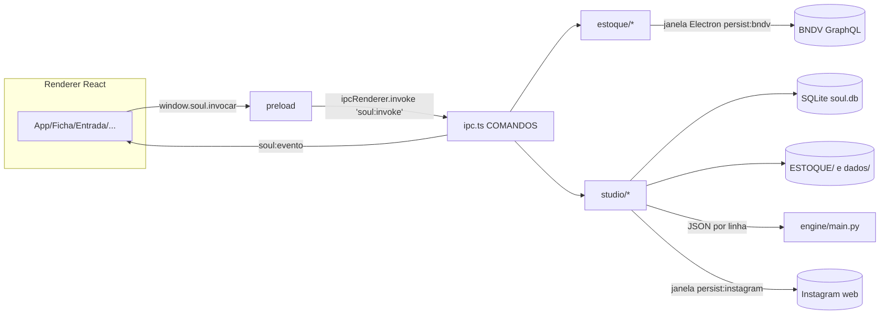

# Manual do Desenvolvedor: fluxo técnico e roadmap de manutenção

Para quem altera o código. Complementa [02 · Arquitetura](02-arquitetura-e-migracao.md), [03 · Vibe code](03-vibe-code.md) e [04 · Dados e backup](04-dados-e-backup.md). Lê-se em paralelo com o [Manual do Usuário](11-manual-do-usuario.md): cada etapa do usuário tem aqui o seu lado técnico.

## 1. Preparar o ambiente

```bat
cd /d "CAMINHO\ate\soul-cars-app"
scripts\instalar.cmd          :: npm ci + tipos
scripts\instalar-motor.cmd    :: uv sync --all-groups (Python 3.12, engine/.venv)
npm run dev
```

Requisitos: Windows x64, Node 22.16+, Git, uv, Tesseract (com `por`) e FFmpeg. O `postinstall` roda `electron-builder install-app-deps`.

## 2. Mapa do repositório

| Pasta | Conteúdo | Observações |
|---|---|---|
| `src/main` | Processo principal | Único lugar com acesso a disco, banco, rede e processos |
| `src/main/estoque` | `extracao.ts` (BNDV), `sync.ts` (CSV e pastas), `balanco.ts`, `relatorio.ts`, `vendas.ts` | Regras financeiras e de pasta |
| `src/main/studio` | `banco.ts`, `esquema.ts`, `arquivos.ts`, `entrada.ts`, `instagram*.ts`, `motor.ts`, `legado.ts` | Banco, arquivos, automações |
| `src/main/ipc.ts`, `ipc-esquemas.ts`, `validacao.ts` | Tabela `COMANDOS` e o esquema de cada um | Única porta de entrada do renderer; tudo é validado antes de executar |
| `src/preload` | `window.soul` | Só `invocar`, `ouvir` e `versoes` |
| `src/compartilhado` | Regras puras (anúncio, entrada, publicação, instagram) | Importadas por main **e** renderer; sem I/O |
| `src/renderer/src` | React: `App`, `Ficha`, `Producao`, `Criativos`, `Anunciar`, `Instagram`, `Entrada`, `Relatorios`, `Configuracoes` | `lib/` tem banco, DES.md, relatórios e XLSX |
| `src/renderer/public/criativo` | Editor de artes em JS/CSS puros, dentro de um iframe | Fora do TypeScript |
| `engine` | Motor Python e `engine/tests` | `uv.lock` versionado |
| `testes` | Vitest (`*.test.ts`) e testes `.mjs` do núcleo | `fixtures/` com `DES.md` e página simulada do Instagram |
| `scripts` | `.cmd` de instalação e `smoke*.cjs` | Smokes usam Electron real |
| `dados-loja`, `legado` | **Locais, fora do Git** | Dados da loja e projetos antigos |

## 3. O fluxo do dado, ponta a ponta



| Etapa do usuário | Comandos/arquivos principais | Saída |
|---|---|---|
| Atualizar BNDV | `atualizarEstoque` em `ipc.ts` → `estoque/extracao.ts` → `sync.ts` → `balanco.ts` → `relatorio.ts` | `bndv_veiculos.csv`, `bndv_vendas.csv`, `_INDICE.csv`, `balanco.json`, `RELATORIO.html`, pastas e `INFO.md/.txt`; eventos `estoque:log` e `estoque:etapa` |
| Entrada | `criarEntrada` em `studio/entrada.ts`, tabela `entrada_arquivos` (migração 6) | Cópias em `FOTOS`/`VIDEO`/`DOC.pdf`; pendências; Lixeira só por hash |
| Ficha | `Ficha.tsx`, `lib/db.ts` → comandos `db_*` → `studio/repositorio.ts`, `lib/des.ts`, motor (`ler_crlv`, `cnw_*`) | Linha do veículo, `DOC.md`, `DES.md` |
| Produção | `Producao.tsx`, `studio/arquivos.ts`, `fotos_renomear`, motor (`remover_fundo`, `fotos_organizar`), `engine/video/*` | Fotos renomeadas, `*_sem_fundo`, `VIDEO_*.mp4`, `ANUNCIO/ANUNCIO_*.mp4` |
| Criativos | `Criativos.tsx` + `public/criativo` via `app-bridge.js`/`flow-bridge.js` | PNGs em `CRIATIVO/` |
| Pronto para anunciar | `compartilhado/anuncio.ts`, `Anunciar.tsx`, `AvisosAnuncio.tsx`, `estoque/vendas.ts`, tabela `anuncios` (migração 7) | Checklist, cartão da campanha, lembrete de pausa |
| Instagram | `Instagram.tsx`, `studio/instagram.ts`, `instagram-plano.ts`, `instagram-browser.ts` | Histórico em `%APPDATA%\soul-cars-app\instagram` |

## 4. Receitas

### 4.1 Adicionar um comando de IPC
1. Escreva a função no módulo do domínio (`estoque/` ou `studio/`).
2. Registre em `COMANDOS` (`src/main/ipc.ts`) **e** declare o esquema em `src/main/ipc-esquemas.ts` (tipos, cabeçalhos, se exige arquivo, e `caminhoEmRaizes` para pastas). Sem esquema o app não abre e o teste `validacao.test.ts` falha. O comando só recebe o que o esquema declara.
3. Chame pelo nome na interface por `lib/desktop.ts`. Binários vão como `Uint8Array` em `corpo`; textos curtos vão em `cabecalhos` (`x-pasta`, `x-nome`, `x-destino` são decodificados no IPC).
4. Rode `npm run tipos`, `npm test` e `npm run smoke`.

### 4.2 Alterar o banco
1. **Nunca edite migração distribuída.** Acrescente a versão 8, 9… em `src/main/studio/esquema.ts`.
2. Reconheça colunas/tabelas já existentes e rode em transação.
3. Escreva a consulta em `studio/repositorio.ts` (recebe a conexão; teste em `testes/repositorio.test.ts` com banco em memória), exponha como comando `db_*` em `ipc.ts` com esquema em `ipc-esquemas.ts`, e chame por `lib/db.ts`. Atualize `Veiculo` em `lib/db.ts` e `EDITAVEIS` em `compartilhado/veiculo.ts`. **A interface não escreve SQL.**
4. Teste com uma cópia do `soul.db` real antes de distribuir.

### 4.3 Adicionar um método ao motor Python
1. Crie a função em `engine/*.py` (importação preguiçosa de bibliotecas pesadas).
2. Registre em `METHODS` (`engine/main.py`). Mensagens: uma linha JSON no stdout; progresso por linha própria antes do resultado.
3. Chame pelo `lib/engine.ts`.
4. Adicione teste em `engine/tests` e rode `npm run test:engine`.
5. O motor já força UTF-8 no stdin/stdout (`main()` e `PYTHONUTF8` no `motor.ts`); não use `print` com outra codificação.

### 4.4 Alterar DES.md ou blocos de publicação
Mexa em `renderer/src/lib/des.ts` / `compartilhado/publicacao.ts` e confira `testes/fixtures/DES.md` (`des.test.ts`). O Instagram usa o bloco **1. TEXTO PRINCIPAL** como legenda do carrossel e o **2.** no Reels.

### 4.5 Mexer no Instagram
Seletores e passos ficam só em `instagram-browser.ts`. Depois de qualquer mudança: `npm run smoke:instagram` e uma validação manual com a conta real (o smoke não detecta mudanças do site).

### 4.6 Segredos
Chaves e tokens nunca vão para o SQLite nem para o renderer. Use `src/main/segredos.ts` (lista `NOMES_PERMITIDOS`), grave pelo comando `segredo_definir` e entregue ao motor/serviço no main (veja `paramsDoMotor` em `ipc.ts`). A interface não consegue ler de volta.

## 5. Regras de negócio que não podem quebrar

- ID BNDV identifica pasta e veículo; renomear no BNDV não renomeia pasta.
- Pastas órfãs e arquivos da loja nunca são apagados; a Entrada nunca move nem sobrescreve.
- Cadastro ativo prevalece sobre duplicata cancelada da mesma placa.
- Consignados não somam custo ao patrimônio; margem é bruta.
- Só um `VIDEO_*.mp4` na pasta; a versão leve vive em `ANUNCIO/`.
- DES.md e DOC.md mantêm o formato (fixture).
- Nenhuma automação ativa ou publica anúncio sozinha; o Instagram nunca republica sem conferência.
- Sem caminhos pessoais, documentos reais, senhas ou tokens no código.
- Nomes, comentários e mensagens em português.

## 6. Testar

| Mudança | Rode |
|---|---|
| Qualquer | `npm run lint`, `npm run tipos`, `npm test`, `npm run formatar:check` |
| Build/`file://` | `npm run build` e `npm start` |
| IPC, preload, editor, disco | `npm run smoke` |
| Instagram | `npm run smoke:instagram` + validação manual |
| Python | `npm run test:engine` |
| Só documentação | Nenhuma suíte |

Os smokes criam estoque e banco temporários; não fazem login no BNDV, não chamam IA paga e não usam documentos reais. O que eles **não** cobrem está listado na [avaliação](10-avaliacao-erros-melhorias.md).

## 7. Publicar uma versão

1. Atualize `version` em `package.json` (e o `CHANGELOG`, quando existir).
2. Rode todas as verificações da seção 6.
3. `npm run empacotar` → instalador NSIS x64 em `dist/` (não versionado; vai em *Releases* do repositório privado).
4. Teste o instalador numa máquina limpa (ainda pendente) e o botão **Instalar / reparar motor Python**.
5. Confirme direitos de marca/logo/trilha antes de qualquer distribuição pública.

## 8. Repositório privado (GitHub)

Repositório **privado** sob a conta da Atto Comunicação. Versione código, recursos, fontes e licenças, `engine`, lockfiles, testes e documentação. Não versione `dados-loja/`, `legado/`, bancos, CSVs, documentos, fotos, sessões ou chaves. Antes de cada push: `git status --short` e `git diff --cached --stat`. Passo a passo em [06 · GitHub](06-github.md). O CI (`.github/workflows/ci.yml`, em `windows-latest`) tem três jobs: **app** (ESLint, tipos, formatação, Vitest, build e `npm audit --audit-level=high`), **motor** (testes Python com FFmpeg, só os grupos `documentos` e `textos`) e **smoke** (os dois smokes em Electron real, depois do job app). O Dependabot (`.github/dependabot.yml`) sugere atualizações de npm, uv e GitHub Actions. O ESLint roda com `--max-warnings 0`: nenhum aviso é aceito.

## 9. Roadmap de manutenção técnica

Derivado da [avaliação](10-avaliacao-erros-melhorias.md); o roadmap do produto está em [planejamento/02-roadmap.md](planejamento/02-roadmap.md).

| Fase | Entrega | Itens | Passa quando |
|---|---|---|---|
| **M0 · Correções** (P) | ~~Acentos do motor (E1)~~, ~~versão do app (E3)~~, ~~`ResourceWarning` (E4)~~, ~~licença (E8)~~ | — | Fase concluída |
| **M1 · Segurança** ~~(feito)~~ | ~~Chave da IA cifrada (E2)~~, ~~`sandbox: true`~~, ~~esquema de argumentos do IPC~~, ~~SQL livre trocado por comandos `db_*`~~ | riscos da seção 2 | Fase concluída |
| **M2 · CI e qualidade** ~~(feito)~~ | ~~`test:engine`, `smoke` e `audit` no CI; ESLint; Dependabot~~ | Melhorias 1, 2, 5 | Falta rodar o CI no GitHub pela primeira vez (ainda não foi executado) |
| **M3 · Testes de interface** (M) | Testes de componentes (Entrada, Anunciar, Ficha); fixtures sintéticas para os testes pulados | Melhorias 3, 4 | Zero testes pulados por dependência externa |
| **M4 · Desempenho e instalação** (M) | Carregamento sob demanda; verificação de requisitos nas Configurações; atualização automática | Melhorias 6–8 | Bundle principal abaixo de 500 kB; instalador testado em máquina limpa |
| **M5 · Operação** (M) | Tela de diagnóstico, log em arquivo, exportar backup completo | Melhorias 10, 12, 17 | Um erro de campo é diagnosticado sem acesso remoto |
| **M6 · Refatoração** (G) | Dividir `entrada.ts`, `relatorio.ts`, `relatorios.ts`, `arquivos.ts`, `Ficha.tsx` e `ipc.ts` por domínio | Melhorias 13–15 | Nenhum arquivo acima de ~400 linhas, sem mudar comportamento |
| **M7 · Integração oficial** (G) | API oficial do Instagram/Meta (depende de conta profissional e verificação da empresa) | Melhoria 16 e roadmap do produto | Publicação por API com aprovação humana e campanha sempre criada pausada |

Tamanhos: P = poucas horas, M = alguns dias, G = semanas.
