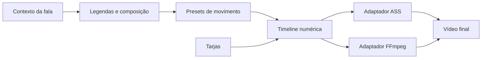

# SOUL Motion — motor interno de animações

Biblioteca atual das legendas: [V7 — contexto, frases e composições](contextual-caption-library.md), com 12 entradas e 8 saídas sobre as curvas e timelines deste motor. Legendas brancas em Lato Black 120, sem mudança do tamanho aprovado.

Visual atual: [tipografia e glow](typography-and-glow.md). O destaque laranja agora usa Lora SemiBold Italic em 84; o corpo usa Lato Black em 90. As legendas usam glow da mesma cor em vez da sombra preta. O núcleo de motion permanece o mesmo.

Implementado em 23/10/2026. O pacote [engine/video/motion](../../apps/engine/video/motion/__init__.py) gera movimento numérico localmente. Ele não transcreve, escolhe palavras, acessa arquivos ou chama modelos/serviços externos. Legendas e tarjas usam o mesmo núcleo; a integração atual é com o vídeo Python, sem uma interface de edição de keyframes no React.

## Pesquisa e decisões

A [especificação CSS Easing do W3C](https://www.w3.org/TR/css-easing-1/) define curvas como transformação do progresso temporal. No Bézier cúbico, o tempo corresponde a x: é necessário resolver esse eixo antes de obter y. O motor faz essa inversão por bisseção; não trata o parâmetro da curva como se já fosse tempo.

O [sistema de motion do Material, na documentação oficial](https://github.com/material-components/material-components-android/blob/master/docs/theming/Motion.md), organiza curvas, durações e respostas de mola como elementos reutilizáveis, separando entrada e saída. Aplicamos essa organização à edição de vídeo; as durações e distâncias abaixo são escolhas do SOUL, não valores prescritos para legendas por essas referências.

O diagnóstico local encontrou entradas de palavras em aproximadamente 200 ms e fragmentação da animação junto do código ASS. A nova arquitetura mantém o relógio contínuo e dá mais tempo para assentar. A posição da composição não é recalculada a cada palavra.

## Arquitetura



| Arquivo | Responsabilidade |
|---|---|
| [curvas.py](../../apps/engine/video/motion/curves.py) | Bézier cúbico, curva de saída, visibilidade e resposta criticamente amortecida sem rebote. |
| [modelo.py](../../apps/engine/video/motion/model.py) | `Chave`, `Trilha`, `Animacao`, relógio absoluto, entrada/permanência/saída e amostragem. |
| [presets.py](../../apps/engine/video/motion/presets.py) | Vocabulário reutilizável de deslocamento, escala, blur e duração; sem regras de anúncio. |
| [ass.py](../../apps/engine/video/motion/ass.py) | Converte estados em eventos ASS para texto e sombra com intervalos idênticos. |
| [ffmpeg.py](../../apps/engine/video/motion/ffmpeg.py) | Compila a timeline em expressões de posição para overlays. |
| [legendas.py](../../apps/engine/video/captions.py) | Adapta o plano semântico ao motion e aplica fonte, texto e cores. |
| [animacao_tarjas.py](../../apps/engine/video/banner_animation.py) | Posiciona nome/informações/valor e usa o núcleo para suas entradas e saídas. |

O núcleo admite trilhas numéricas genéricas. O adaptador ASS suporta `x`, `y`, `escala`, `opacidade` e `blur`; rejeita propriedades ainda não suportadas. Pode gerar texto, glow ou sombra opcional. O adaptador FFmpeg exporta a propriedade solicitada em uma expressão numérica. Transparência das tarjas usa o filtro nativo `fade` do FFmpeg; não é uma simulação de blur ou alfa por pixel no núcleo.

## Uso

Exemplo executado com `engine/video` no caminho de importação, como já faz o render:

```python
from motion import transicao
from motion.ass import eventos

animacao = transicao(
    inicio=1.0, fim=3.0,
    inicial={"x": 540, "y": 1418, "escala": 0.98, "opacidade": 0, "blur": 2.5},
    estavel={"x": 540, "y": 1400, "escala": 1, "opacidade": 1, "blur": 0},
    final={"x": 540, "y": 1396, "escala": 1, "opacidade": 0, "blur": 1.2},
    entrada=0.38, saida=0.18,
)
estado = animacao.estado(1.2)  # tempo absoluto do vídeo
eventos_texto = eventos(animacao)
eventos_sombra = eventos(animacao, sombra=True)
```

Uma trilha contém keyframes ordenados: `Trilha((Chave(0, 0), Chave(0.4, 1, "suave")))`. A curva de uma chave determina como chegar a ela. Antes da primeira chave e depois da última, o valor é limitado ao extremo. Valores não finitos, tempos repetidos e intervalos inválidos são rejeitados.

## Parâmetros atuais

- Corpo branco em maiúsculas com tamanho-base 90; destaque laranja com fonte diferente em tamanho-base 100, antes 126. A redução proporcional do bloco continua funcionando.
- Presets: blur, subida, deslize, zoom, pop, revelar, cascata e acende. Variações compartilham a mesma linguagem visual; não são o código antigo de curvas com outro nome. Revelar usa movimento/blur suave, sem corte por máscara.
- Entrada-base de 380–440 ms e mais 40 ms para destaques; deslocamentos pequenos de 4–26 px, zoom de poucos pontos percentuais e intensidade limitada. Pop usa resposta amortecida, sem oscilação exagerada.
- Permanência estável e saída de 180 ms com transparência, deslocamento de 4 px e blur leve. Em intervalos curtos, entrada e saída são comprimidas juntas, preservando 20% do tempo para repouso.
- Texto e sombra partilham tempo, deslocamento e escala. A sombra acrescenta apenas deslocamento vertical, blur e multiplicador de opacidade. Não há `fad` reiniciado em cada fragmento ASS.
- ASS é amostrado na grade de centésimos de segundo, até 100 amostras/s. Isso não transforma o vídeo em 100 fps. FFmpeg usa aproximação da mesma timeline a 60 amostras/s para posições. Períodos constantes viram um único intervalo, sem keyframes desnecessários por quadro.
- Nome, informações e valor permanecem nas tarjas até o fechamento da cena. A saída continua apenas nos últimos 420 ms, com pequeno escalonamento. O cartão final mantém seu fluxo.

## Verificação e extensão

[test_motion.py](../../apps/engine/tests/test_motion.py) verifica inversão Bézier, limites e monotonia, velocidade final, resposta amortecida, relógio absoluto, continuidade entre segmentos, erro de amostragem, intervalos curtos, sincronização da sombra e equivalência numérica do adaptador FFmpeg. [test_legendas.py](../../apps/engine/tests/test_captions.py) continua exercitando ASS/libass real e os presets de tarjas no FFmpeg.

Para acrescentar movimento, criar ou parametrizar um preset. Para outra propriedade visual, primeiro estender o adaptador correspondente e adicionar a verificação da propriedade. Não voltar a inserir curvas diretamente na montagem de strings de legenda. A forma exata do movimento continua determinística e não depende de serviço pago, rede ou pacote adicional.

A prévia V3 usa os mesmos 30 segundos e a mesma transcrição do Argo das versões anteriores, agora renderizados em 60 fps. Os quadros originais do carro mantêm a cadência da gravação; os elementos gráficos são avaliados na nova cadência. Os arquivos reais do estoque não são alterados.
